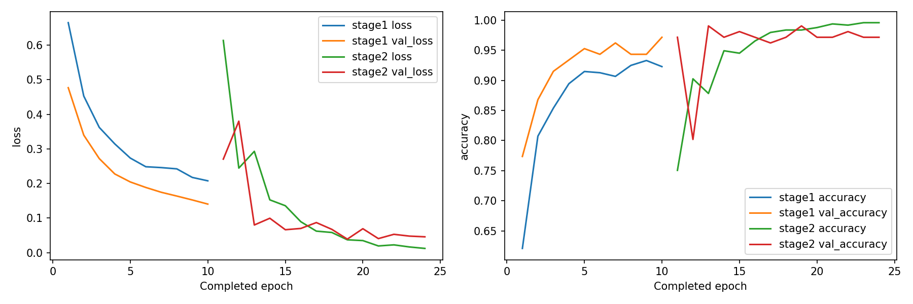
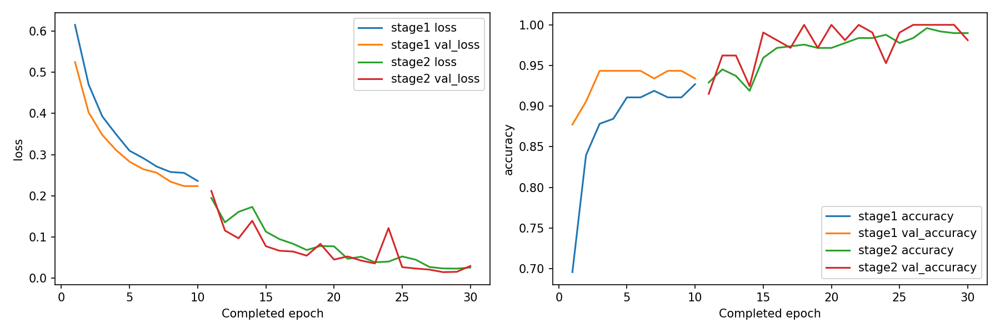
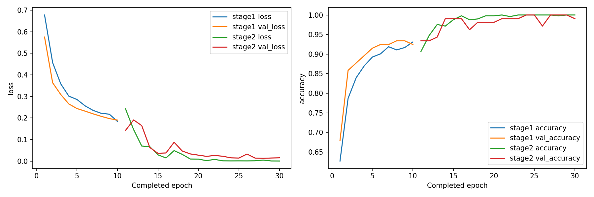

# Individual core models: comparative training report

Record/import date: **27 November 2026**. All three core models completed two-stage Kaggle training, as reported by the user and the supplied completed selection records. The new EfficientNetB0/ResNet50 record-directory dates are import dates, not inferred training timestamps.

**Scope: validation-selected results, not held-out test performance.** No test predictions or test evaluation artifacts were provided. This report does not retrain a model, evaluate images, change a frozen split, tune an ensemble or claim clinical validity.

## Sources and preservation

The supplied `core_models_results.zip` contains 24 artifacts: six epoch-wise CSVs, six JSON histories, six stage summaries, three checkpoint selections and three original PNG graphs. All were copied byte-for-byte into per-model directories. The original CSV CRLF line endings are retained, with scoped Git attributes preventing normalization during checkout. The archive SHA-256 is `da2d59ed0580b4ae154919f1eb1b5ed5cc015ab23604f7fec64ec32b05d233c1`. The source ZIP itself, datasets, row-level metadata and weights are not committed.

[Artifact manifest](core_models_artifact_manifest_2026-11-27.json) maps every original archive member to its repository path, byte count and SHA-256. [Full-precision comparison JSON](core_models_comparison_2026-11-27.json) preserves the derived calculations. The earlier [MobileNetV2 account](mobilenet_v2_kaggle_2026-11-26/README.md), its JSON, console log and inline curve are unchanged; the newly supplied MobileNetV2 summaries exactly match that account.

## Stage 1 and Stage 2 validation metrics

Each row is evaluated at that stage's **minimum validation-loss epoch**, not necessarily the final epoch. Best epochs are one-based within each stage; the original CSV `epoch` column is zero-based. Accuracy is a percentage; AUC, precision and recall are ratios. Display rounding does not alter the original files.

| Model | Stage | Best / completed epoch | Val loss | Val accuracy | Val ROC-AUC | Val precision | Val recall |
| --- | --- | --- | --- | --- | --- | --- | --- |
| MobileNetV2 | stage1 | 10 / 10 | 0.140319 | 97.1698% | 0.997463822 | 0.952381 | 1.000000 |
| MobileNetV2 | stage2 | 9 / 14 | 0.038979 | 99.0566% | 0.999637604 | 1.000000 | 0.983333 |
| EfficientNetB0 | stage1 | 9 / 10 | 0.223530 | 94.3396% | 0.985869527 | 0.935484 | 0.966667 |
| EfficientNetB0 | stage2 | 18 / 20 | 0.014796 | 100.0000% | 0.999999940 | 1.000000 | 1.000000 |
| ResNet50 | stage1 | 10 / 10 | 0.190144 | 92.4528% | 0.984601378 | 0.919355 | 0.950000 |
| ResNet50 | stage2 | 18 / 20 | 0.012717 | 100.0000% | 1.000000000 | 1.000000 | 1.000000 |

EfficientNetB0's stored Stage 2 validation AUC is `0.9999999403953552`, numerically close to but not exactly 1.0; the original value is preserved. Perfect observed validation accuracy for EfficientNetB0 and ResNet50 does not establish perfect generalization.

## Training metrics at the same selected epochs

These are logged training-epoch measurements with training augmentation/dropout active, not a separate deterministic evaluation of the selected model on the training set.

| Model | Stage | Train loss | Train accuracy | Train ROC-AUC | Train precision | Train recall |
| --- | --- | --- | --- | --- | --- | --- |
| MobileNetV2 | stage1 | 0.207624 | 92.2921% | 0.975857377 | 0.922261 | 0.942238 |
| MobileNetV2 | stage2 | 0.036988 | 98.3773% | 0.999431789 | 0.985560 | 0.985560 |
| EfficientNetB0 | stage1 | 0.255766 | 91.0751% | 0.967818260 | 0.914591 | 0.927798 |
| EfficientNetB0 | stage2 | 0.023717 | 99.1886% | 0.999774396 | 0.989247 | 0.996390 |
| ResNet50 | stage1 | 0.184210 | 93.1035% | 0.984055340 | 0.926316 | 0.953069 |
| ResNet50 | stage2 | 0.004450 | 99.7972% | 0.999983311 | 1.000000 | 0.996390 |

## Fine-tuning changes

Changes compare each model's best Stage 2 epoch with its best Stage 1 epoch. Absolute loss decrease = Stage 1 val loss − Stage 2 val loss; relative decrease = 100 × absolute decrease / Stage 1 val loss. Accuracy changes are **percentage points (pp)**, not relative percentage gains. Other deltas are Stage 2 − Stage 1.

| Model | Val loss decrease | Relative loss decrease | Accuracy change (pp) | AUC change | Precision change | Recall change |
| --- | --- | --- | --- | --- | --- | --- |
| MobileNetV2 | 0.101340 | 72.2212% | +1.8868 | +0.002173781 | +0.047619 | -0.016667 |
| EfficientNetB0 | 0.208734 | 93.3807% | +5.6604 | +0.014130414 | +0.064516 | +0.033333 |
| ResNet50 | 0.177428 | 93.3121% | +7.5472 | +0.015398622 | +0.080645 | +0.050000 |

All three models reduce validation loss and increase validation accuracy/AUC. MobileNetV2's validation recall falls from 1.000000 to 0.983333 while precision rises to 1.000000; fine-tuning does not improve every metric. The recorded selection rule remains minimum validation loss, not whichever metric is largest.

## Selected checkpoints

All three selection files mark the run complete and select Stage 2. These paths reference private Kaggle outputs; the corresponding weights are deliberately absent from Git.

| Model | Selected stage | Stage epoch | Val loss | Checkpoint reference | Original selection |
| --- | --- | --- | --- | --- | --- |
| MobileNetV2 | stage2 | 9 | 0.038978897 | `checkpoints/core/mobilenet_v2/stage2/best.keras` | [selection.json](mobilenet_v2_kaggle_2026-11-26/metrics/selection.json) |
| EfficientNetB0 | stage2 | 18 | 0.014796104 | `checkpoints/core/efficientnet_b0/stage2/best.keras` | [selection.json](efficientnet_b0_kaggle_2026-11-27/metrics/selection.json) |
| ResNet50 | stage2 | 18 | 0.012716666 | `checkpoints/core/resnet50/stage2/best.keras` | [selection.json](resnet50_kaggle_2026-11-27/metrics/selection.json) |

ResNet50 has the lowest recorded selected validation loss (`0.012716665863990784`), followed by EfficientNetB0 (`0.014796104282140732`) and MobileNetV2 (`0.03897889703512192`). This is a descriptive single-run validation ranking, not evidence of statistical superiority, calibrated clinical risk or deployment readiness. No model size, inference latency or browser-memory results were supplied.

## Epoch-artifact verification and numerical notes

All **84 epoch rows across six stages** were checked. CSV epoch counts/indexing, history lengths, all training/validation metrics, minimum-loss epochs, stage summaries and selected checkpoints agree. Each model's two stage summaries and selection share the same recorded contract hash. Cross-model hashes differ because the contract includes the model configuration; they are not a standalone proof of identical data partitions.

Eight learning-rate entries differ between CSV and JSON histories at reduction boundaries. The CSV logger preserves the logged pre-reduction rate; the later JSON recorder reads the optimizer's updated post-reduction rate. Every non-final discrepancy agrees with the next CSV epoch's rate. The original values were **not normalized or overwritten**. The existing callback ordering explains this timing distinction; training code is unchanged.

| Model | Stage | Stage epoch | CSV learning rate | JSON learning rate |
| --- | --- | --- | --- | --- |
| MobileNetV2 | stage2 | 7 | 9.9999997e-05 | 4.9999999e-05 |
| MobileNetV2 | stage2 | 11 | 4.9999999e-05 | 2.4999999e-05 |
| MobileNetV2 | stage2 | 13 | 2.4999999e-05 | 1.25e-05 |
| EfficientNetB0 | stage2 | 20 | 9.9999997e-05 | 4.9999999e-05 |
| ResNet50 | stage2 | 3 | 9.9999997e-05 | 4.9999999e-05 |
| ResNet50 | stage2 | 7 | 4.9999999e-05 | 2.4999999e-05 |
| ResNet50 | stage2 | 13 | 2.4999999e-05 | 1.25e-05 |
| ResNet50 | stage2 | 20 | 1.25e-05 | 6.2499998e-06 |

One ResNet50 Stage 2 **training** AUC entry at epoch 16 is `1.0000001192092896`, a floating-point-sized overshoot. Verification permits a numerical tolerance of 1e-6 for bounded metrics and records this observation; it does not interpret AUC >1 as meaningful or clamp the source value. Selected validation metrics are unaffected.

## Original histories and graphs

### MobileNetV2

[Model record](mobilenet_v2_kaggle_2026-11-26/ARTIFACTS.md) · [Stage 1 CSV](mobilenet_v2_kaggle_2026-11-26/histories/stage1/epochs.csv) · [Stage 1 JSON](mobilenet_v2_kaggle_2026-11-26/histories/stage1/history.json) · [Stage 2 CSV](mobilenet_v2_kaggle_2026-11-26/histories/stage2/epochs.csv) · [Stage 2 JSON](mobilenet_v2_kaggle_2026-11-26/histories/stage2/history.json)



### EfficientNetB0

[Model record](efficientnet_b0_kaggle_2026-11-27/README.md) · [Stage 1 CSV](efficientnet_b0_kaggle_2026-11-27/histories/stage1/epochs.csv) · [Stage 1 JSON](efficientnet_b0_kaggle_2026-11-27/histories/stage1/history.json) · [Stage 2 CSV](efficientnet_b0_kaggle_2026-11-27/histories/stage2/epochs.csv) · [Stage 2 JSON](efficientnet_b0_kaggle_2026-11-27/histories/stage2/history.json)



### ResNet50

[Model record](resnet50_kaggle_2026-11-27/README.md) · [Stage 1 CSV](resnet50_kaggle_2026-11-27/histories/stage1/epochs.csv) · [Stage 1 JSON](resnet50_kaggle_2026-11-27/histories/stage1/history.json) · [Stage 2 CSV](resnet50_kaggle_2026-11-27/histories/stage2/epochs.csv) · [Stage 2 JSON](resnet50_kaggle_2026-11-27/histories/stage2/history.json)



## Interpretation limits and next work

The bundle records TensorFlow 2.21.0 and Keras 3.13.2 for every stage. Python version and GPU hardware are not included for the new EfficientNetB0/ResNet50 artifacts; the earlier MobileNetV2 record documents its own Kaggle environment. Do not copy that hardware/runtime detail to the other models without evidence.

The comparisons follow the existing ACRIMA frozen-split workflow. The archive contains no dataset manifest, full configuration/contract file, images or checkpoints, so this import cannot independently audit cross-model row-level split identity, patient independence, ImageNet initialization or model architecture from the files alone. No such inputs were changed. The previously recorded 493 train / 106 validation / 106 test counts belong to the existing MobileNetV2 provenance, rather than a newly inspected manifest for each model.

Use the untouched test partition only in the future evaluation phase after freezing analysis choices. External-dataset validation, uncertainty estimates, calibration and ensemble optimization remain separate work. Notebook 03 remains generic and output-free with all training/setup/download flags disabled by default.

Reproduce the artifact checks without the source ZIP or TensorFlow:

```bash
python scripts/verify_experiment_artifacts.py
```
