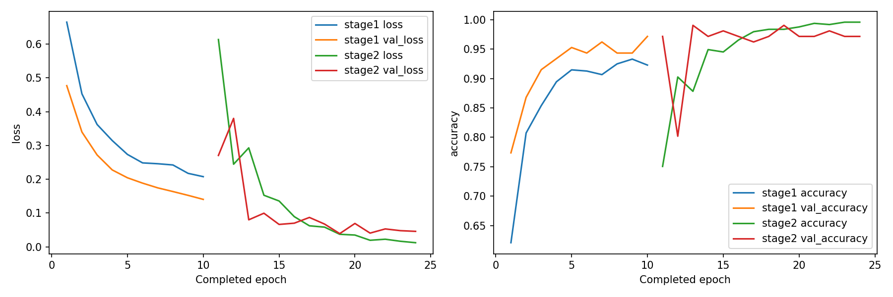

# MobileNetV2 — complete archive addendum

The original 26 November MobileNetV2 narrative, results JSON, console output and inline plot remain unchanged. This addendum supplies the full epoch-wise histories and original saved graph provided on 27 November. Earlier statements that full histories were unavailable describe the earlier evidence state, not this new archive. Both imported stage summaries and selection exactly match the preserved results JSON.

These are **validation-selected training results, not test results**. No model was retrained or evaluated during import. Original archive artifacts are retained byte-for-byte; weights and dataset files are not included.

## Best epochs and validation measurements

| Model | Stage | Best / completed epoch | Val loss | Val accuracy | Val ROC-AUC | Val precision | Val recall |
| --- | --- | --- | --- | --- | --- | --- | --- |
| MobileNetV2 | stage1 | 10 / 10 | 0.140319 | 97.1698% | 0.997463822 | 0.952381 | 1.000000 |
| MobileNetV2 | stage2 | 9 / 14 | 0.038979 | 99.0566% | 0.999637604 | 1.000000 | 0.983333 |

## Training measurements at those epochs

| Model | Stage | Train loss | Train accuracy | Train ROC-AUC | Train precision | Train recall |
| --- | --- | --- | --- | --- | --- | --- |
| MobileNetV2 | stage1 | 0.207624 | 92.2921% | 0.975857377 | 0.922261 | 0.942238 |
| MobileNetV2 | stage2 | 0.036988 | 98.3773% | 0.999431789 | 0.985560 | 0.985560 |

Stage 2 decreases validation loss by **72.2212%** relative to Stage 1 and changes validation accuracy by **+1.8868 pp**. The [selection record](metrics/selection.json) selects Stage 2 epoch **9**, referencing `/kaggle/working/artifacts/runs/development/checkpoints/core/mobilenet_v2/stage2/best.keras`. No file at that checkpoint path is committed.

## Unchanged source artifacts

| Stage | Epoch CSV | JSON history | Best-epoch metrics |
| --- | --- | --- | --- |
| Stage 1 | [epochs.csv](histories/stage1/epochs.csv) | [history.json](histories/stage1/history.json) | [stage1.json](metrics/stage1.json) |
| Stage 2 | [epochs.csv](histories/stage2/epochs.csv) | [history.json](histories/stage2/history.json) | [stage2.json](metrics/stage2.json) |

The [comparative report](../core_models_comparison_2026-11-27.md) explains all fine-tuning deltas, CSV/JSON learning-rate timing differences and numerical precision notes. The [source manifest](../core_models_artifact_manifest_2026-11-27.json) records archive-member hashes and paths. No held-out test results, confidence intervals, ensemble measurements or clinical validation were provided.
