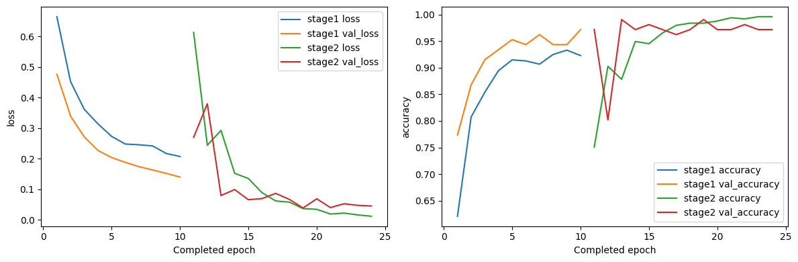

# MobileNetV2 ACRIMA experiment — 26 November 2026

This is a record of the user's completed Kaggle experiment, separated from the reusable training notebook. These are **validation-selected experimental results**, not held-out test performance or clinical validation. The update did not rerun real-data training or independently inspect the private checkpoints.

## Recorded results

Values are from the best validation-loss epoch of each stage; they are not the final epoch's metrics unless that epoch was best. Full-precision values remain in [results.json](results.json).

| Measurement | Stage 1: frozen backbone | Stage 2: final-20-layer fine-tuning |
| --- | ---: | ---: |
| Completed epochs | 10 | 14 of a maximum 20 |
| Best epoch (within stage) | 10 | 9 |
| Training loss | 0.207624 | 0.036988 |
| Training accuracy | 92.2921% | 98.3773% |
| Training ROC-AUC | 0.975857 | 0.999432 |
| Training precision | 0.922261 | 0.985560 |
| Training recall | 0.942238 | 0.985560 |
| Validation loss | 0.140319 | **0.038979** |
| Validation accuracy | 97.1698% | **99.0566%** |
| Validation ROC-AUC | 0.997464 | **0.999638** |
| Validation precision | 0.952381 | 1.000000 |
| Validation recall | 1.000000 | 0.983333 |
| Recorded learning rate at best epoch | 0.001000 | 0.000050 |

The saved selection chooses **Stage 2, epoch 9**, with validation loss `0.03897889703512192`. Both stage summaries and selection have the same recorded contract hash, `c17f27a23a9db65edf86078755a4949d10471c49a6b2a606463b0e383d4ad019`. The checkpoint path is a reference to a private artifact; no `.keras` file is included here.

## Runtime and fixed partitions

The export reports Python **3.13.16**, TensorFlow **2.21.0**, Keras **3.13.2**, two visible Tesla T4 GPUs, and execution on GPU:0. It does not establish that both GPUs participated in training; no distributed-training claim is made.

| Frozen partition | Label 0 | Label 1 | Total |
| --- | ---: | ---: | ---: |
| Training | 216 | 277 | 493 |
| Validation | 46 | 60 | 106 |
| Test (reserved) | 47 | 59 | 106 |
| Total | 309 | 396 | 705 |

These are aggregate counts printed by the supplied notebook, not a copy of its row-level manifest. The Kaggle workflow remapped image paths from Drive to an attached flat image directory; labels, image IDs, patient fields and split assignments were retained. This repository update does not recalculate or change those assignments. The existing architecture, preprocessing and two-stage training methodology are unchanged.

## Evidence and provenance

- **Stage 1:** the user separately provided the full `metrics/mobilenet_v2/stage1.json` summary, preserved verbatim as the `stage1` object in `results.json`. The exported notebook's Stage 1 cell instead contains a later `FileExistsError` from the intentional existing-artifacts guard. That rerun error is not the original training result and does not invalidate the supplied completed summary.
- **Stage 2:** the executed Kaggle notebook contains its epoch log, full summary, selected checkpoint and completed-run curve. The JSON summary and selection are copied into `results.json`; [stage2-console.txt](stage2-console.txt) preserves the console text with terminal color escapes removed.
- **Curve:** [training-curves.png](training-curves.png) is the original notebook's embedded plot, extracted unchanged. It was not regenerated or estimated from the displayed pixels. Exact Stage 1 epoch-by-epoch history is not supplied; it is not reconstructed from this image.
- **Source:** the user-supplied Kaggle notebook had SHA-256 `4c5ac82ef267e6b0790c6503dda477fd5a7cf02d4e8526f285539b661f611244`. It was compared with GitHub commit `e14a60c` (the previous Colab version), retaining the earlier reusable Phase 3 methodology introduced in `3042e4a`.

No datasets, image files, row-level metadata, model weights or backup ZIPs are included. Only aggregate experimental records, a metric curve and textual logs are committed.

## Review of notebook changes

| Kaggle export change | Reusable version |
| --- | --- |
| Hard-coded `PLATFORM='kaggle'` | Kaggle environment/path checks take priority, with Colab and local fallbacks |
| Python guard expanded to 3.13 only inside the notebook | Guard, package Python metadata and dependency markers support Python 3.10–3.13 |
| Source manifests/session remapped in unconditional setup cells | Explicit opt-in relocation in a shared utility; original files and every non-path CSV field preserved; collisions/missing images/conflicting outputs rejected |
| Cloud setup, download, model construction and Stage 2 enabled | All side-effect opt-ins disabled, weights=None, clone/install disabled |
| Automatic stage/full backup ZIP cells | Removed from reusable notebook; backups remain private and ZIPs are ignored by Git |
| Executed outputs, plot and result dictionaries mixed with reusable code | Results/log/curve preserved here; reusable notebook has empty outputs/execution counts |

The original Stage 1/Stage 2 calls and core training modules were retained. Checkpoint contract validation is unchanged: relocation does not rewrite a saved checkpoint's contract hash or bypass recovery checks. Reusing checkpoints requires matching effective paths/configuration, not merely matching aggregate partition counts.

## Limits

This is one reported MobileNetV2 run. No held-out test evaluation, ensemble comparison, external-dataset validation, confidence intervals or clinical diagnostic claims are established. Patient independence cannot be inferred from image numbers. The small validation set was used for checkpoint selection, so its metrics are not an unbiased independent test estimate.
