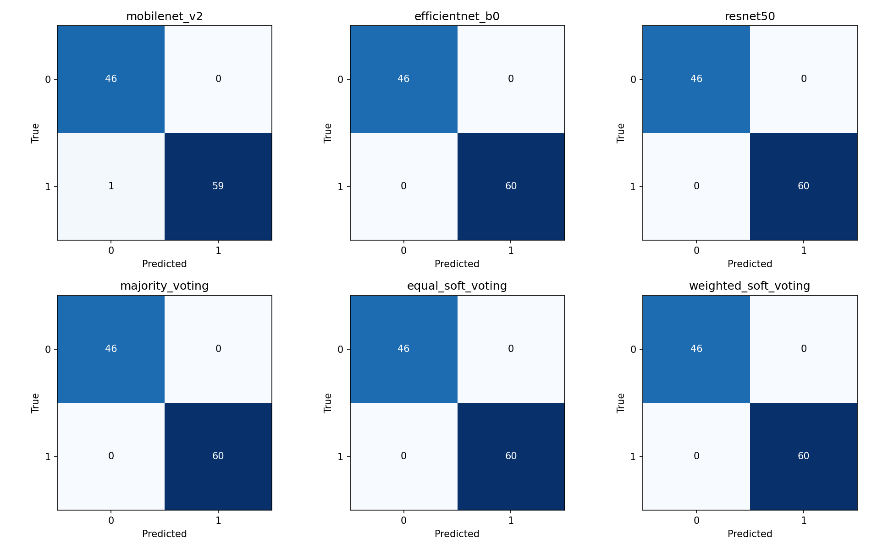
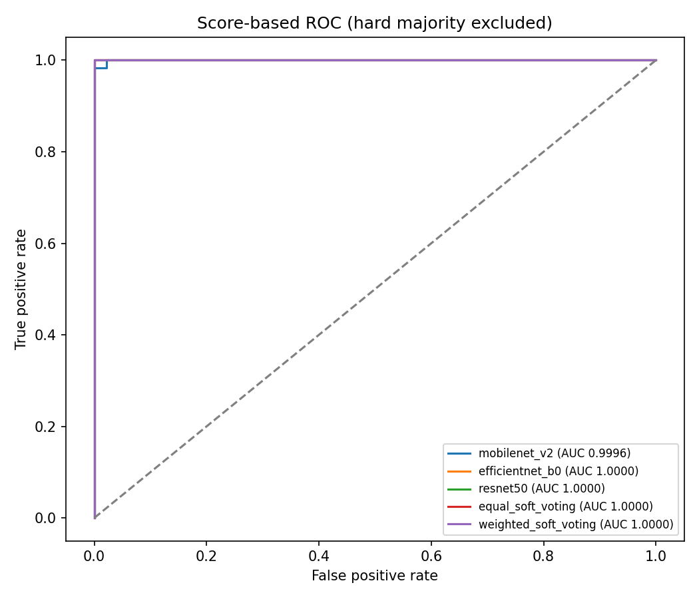
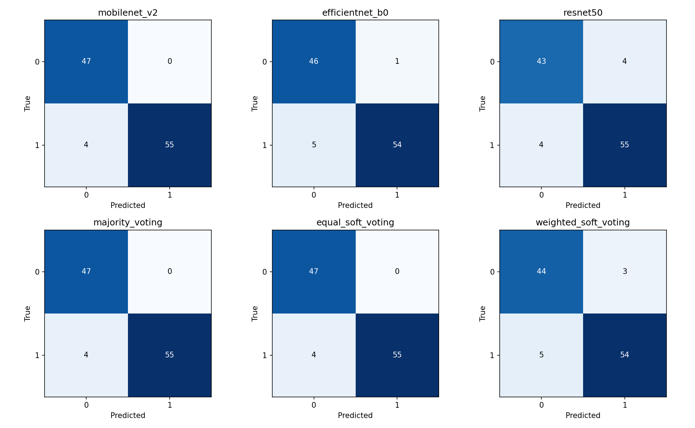
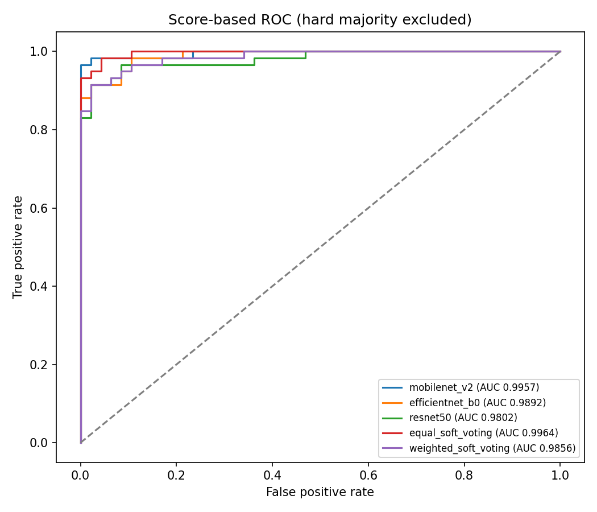

# Phase 4 — Kaggle validation and held-out test results

Imported on 27 November 2026 from the user-supplied `phase4_evaluation_results.zip`, following successful execution of Notebooks 04 and 05 on Kaggle. This is an archive of actual supplied results, not a new inference run. The import date is not an independently verified execution timestamp. Original aggregate CSV/JSON files, PNG graphs, protocol, frozen configuration and completion records are preserved byte-for-byte; [the manifest](artifact_manifest.json) records every source member and its disposition.

## Protocol and provenance

The three selected Stage 2 checkpoints are MobileNetV2 epoch 9, EfficientNetB0 epoch 18 and ResNet50 epoch 18. Their selection records agree with the earlier individual-model archives. The original frozen record retains checkpoint SHA-256 values, training contracts, graph hashes, preprocessing and manifest fingerprint. No checkpoints are included or reloaded for this documentation task.

Notebook 04 produced individual validation predictions. Notebook 05 searched the predefined 0.05-step nonnegative simplex grid plus exact equal weights (232 candidates), minimizing validation binary cross-entropy with the recorded deterministic tie rule. Selected weights, in MobileNetV2 / EfficientNetB0 / ResNet50 order, were **0.00 / 0.15 / 0.85**. Equal voting uses exactly one third per model. All classifications use the predefined **0.5** threshold (score ≥ threshold); majority voting thresholds the individual scores and takes the majority. Neither weights nor threshold were changed after test evaluation.

The frozen configuration records `selection_partition: validation`, `test_used_for_selection: false` and status `frozen_before_test`. Test start/completion records reference its seal `884714192aab6a082fefd35d72b12a013721a00a3c6f7c90bd24c916739b3b3d`. These are internally consistent supplied records; hashes establish integrity, not independent proof of chronology or absence of prior test exposure.

Validation and test each contain **106 images**. Validation has 46 non-glaucoma / 60 glaucoma images; held-out test has 47 / 59. Source prediction keys are disjoint between these two partitions. No splitting, training, checkpoint recovery or new test inference was performed during import.

## Validation performance — used for selection

Percentages are rounded to two decimals; AUC and BCE to six decimals. Full precision remains in the original JSON/CSV artifacts. Hard majority voting has no probability score, so its AUC/BCE are not applicable.

| Method | Accuracy % | Precision % | Recall % | Specificity % | F1 % | ROC-AUC | BCE | TN / FP / FN / TP |
| --- | ---: | ---: | ---: | ---: | ---: | ---: | ---: | --- |
| MobileNetV2 | 99.06 | 100.00 | 98.33 | 100.00 | 99.16 | 0.999638 | 0.038979 | 46 / 0 / 1 / 59 |
| EfficientNetB0 | 100.00 | 100.00 | 100.00 | 100.00 | 100.00 | 1.000000 | 0.014796 | 46 / 0 / 0 / 60 |
| ResNet50 | 100.00 | 100.00 | 100.00 | 100.00 | 100.00 | 1.000000 | 0.012717 | 46 / 0 / 0 / 60 |
| Majority voting | 100.00 | 100.00 | 100.00 | 100.00 | 100.00 | — | — | 46 / 0 / 0 / 60 |
| Equal-weight soft voting | 100.00 | 100.00 | 100.00 | 100.00 | 100.00 | 1.000000 | 0.019848 | 46 / 0 / 0 / 60 |
| Validation-optimized weighted voting | 100.00 | 100.00 | 100.00 | 100.00 | 100.00 | 1.000000 | 0.012632 | 46 / 0 / 0 / 60 |

[Original metrics](validation/ensemble/metrics.json) · [CSV table](validation/ensemble/metrics_comparison.csv)

## Held-out test performance — fixed protocol

Percentages are rounded to two decimals; AUC and BCE to six decimals. Full precision remains in the original JSON/CSV artifacts. Hard majority voting has no probability score, so its AUC/BCE are not applicable.

| Method | Accuracy % | Precision % | Recall % | Specificity % | F1 % | ROC-AUC | BCE | TN / FP / FN / TP |
| --- | ---: | ---: | ---: | ---: | ---: | ---: | ---: | --- |
| MobileNetV2 | 96.23 | 100.00 | 93.22 | 100.00 | 96.49 | 0.995673 | 0.124073 | 47 / 0 / 4 / 55 |
| EfficientNetB0 | 94.34 | 98.18 | 91.53 | 97.87 | 94.74 | 0.989181 | 0.168084 | 46 / 1 / 5 / 54 |
| ResNet50 | 92.45 | 93.22 | 93.22 | 91.49 | 93.22 | 0.980166 | 0.317995 | 43 / 4 / 4 / 55 |
| Majority voting | 96.23 | 100.00 | 93.22 | 100.00 | 96.49 | — | — | 47 / 0 / 4 / 55 |
| Equal-weight soft voting | 96.23 | 100.00 | 93.22 | 100.00 | 96.49 | 0.996394 | 0.102667 | 47 / 0 / 4 / 55 |
| Validation-optimized weighted voting | 92.45 | 94.74 | 91.53 | 93.62 | 93.10 | 0.985575 | 0.190956 | 44 / 3 / 5 / 54 |

[Original metrics](test/metrics.json) · [CSV table](test/metrics_comparison.csv)

## Equal versus validation-optimized voting

The optimized mixture improved validation BCE from **0.019847892685185196** (equal) to **0.012632421744333497** (weighted). Both achieved 100% validation accuracy and AUC 1.0. On the held-out test split, that ordering reversed: equal voting achieved **96.23%** accuracy (102/106) and weighted voting **92.45%** (98/106), a difference of **3.77 percentage points**. Test BCE was **0.10266725359724482** versus **0.1909555663757835**, and ROC-AUC **0.99639379733141** versus **0.98557518932564**, respectively.

Equal-weight voting **matched the best individual test accuracy**, MobileNetV2's 96.23%, while achieving the **lowest test BCE and highest test ROC-AUC among all score-based methods**. It did not exceed MobileNetV2's classification accuracy. Majority voting also tied that accuracy. The methods' matching counts do not imply identical per-image predictions.

The validation-selected mixture assigned 85% to ResNet50 and zero to MobileNetV2. ResNet50 had the smallest individual validation BCE but the largest individual test BCE; MobileNetV2 had the strongest individual test accuracy. This is consistent with weight selection on a small validation sample failing to generalize as well as equal averaging. It does not establish a causal explanation or statistical significance. Lower BCE measures better observed score fit here, not proof of clinical calibration. The original optimized configuration remains frozen; observing equal voting's better test scores is a descriptive comparison, not permission to retune or declare a newly test-selected deployable system.

## Disagreement and limitations

The CNNs disagreed on **1/106 validation images (0.94%)** and **12/106 test images (11.32%)**. Each pair disagreed on eight test images. Pairwise both-wrong counts were 1 (MobileNetV2/EfficientNetB0), 2 (MobileNetV2/ResNet50) and 3 (EfficientNetB0/ResNet50). Original aggregate disagreement summaries are archived alongside the six-method reports.

These are image-level splits from one ACRIMA dataset, not patient-independent or external validation. Patient identifiers were unavailable; related images across partitions cannot be ruled out by disjoint filenames. Validation was reused for checkpoint and ensemble selection, so its high scores are optimistic selection results. The test sample is small, no confidence intervals or significance analyses are supplied, and the archive does not establish prospective clinical performance, cross-dataset generalization, calibration or browser resource costs. No clinical diagnoses should be inferred.

## Privacy and redistribution review

Inspection of every CSV header and record found original image filenames, binary glaucoma labels, split membership, model scores and prediction decisions in the per-image tables. No patient-name or patient-ID column was present, but absence of those fields does not establish anonymity. Dataset filenames allow linkage back to the original images and annotations. Per-image files are therefore **withheld**, not pseudonymized or republished. Fine-grained ROC-point CSVs are also withheld because their thresholds expose individual score values; the original aggregate ROC PNGs remain intact. The source ZIP stays outside Git.

The [original ACRIMA dataset landing page](https://figshare.com/articles/dataset/CNNs_for_Automatic_Glaucoma_Assessment_using_Fundus_Images_An_Extensive_Validation/7613135) could not be fetched during this review (HTTP 403). No redistribution permission was established from that page or supplied in the ZIP. This record makes no assertion about the dataset's license; retain source predictions privately and verify the applicable original terms before any later release. No retinal images, annotations table, patient identifiers, model weights, datasets or ZIPs are committed.

The public frozen configuration and validation handoff record retain original Kaggle account/dataset/checkpoint paths and cryptographic fingerprints to preserve their seals; these reference the supplied research environment, not patient files. They contain no credentials or per-image rows. The handoff record references hashes of withheld files; it is provenance only and cannot drive an inference workflow without the private original artifacts. This deliberately incomplete public archive is not a substitute for the private run directory.

## Verification

At import, the private source predictions were read in memory and reproduced all six methods' metrics and disagreement counts using the existing evaluation utilities; the validation-only search reproduced the frozen weights. Validation/test image keys were disjoint, frozen/handoff seals and prediction-file hashes matched, and protocol and test markers agreed. This was arithmetic verification of supplied predictions, not retraining or new test-set inference.

Run `python scripts/verify_phase4_artifacts.py` for read-only public-archive checks: original file hashes, canonical seals, protocol links, checkpoint selections, aggregate CSV/JSON agreement, confusion-count-derived metrics and the reported ranking. That verifier cannot reproduce AUC/BCE from private predictions or independently verify frozen split membership, checkpoint bytes or execution order. Notebooks 04 and 05 remain unchanged, output-free, and disabled by default.
