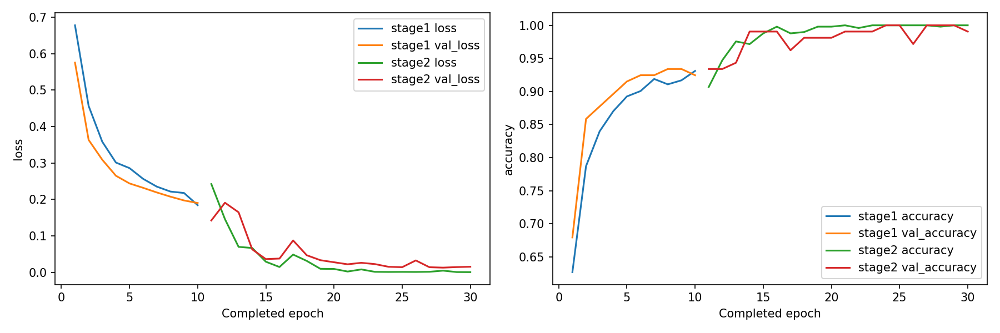

# ResNet50 — individual Kaggle training record

This record was added on 27 November 2026 from the user-supplied core-model results archive. The date is the import/record date; exact training timestamps and GPU/Python details were not supplied. The recorded TensorFlow version is 2.21.0 and Keras version is 3.13.2 for both stages.

These are **validation-selected training results, not test results**. No model was retrained or evaluated during import. Original archive artifacts are retained byte-for-byte; weights and dataset files are not included.

## Best epochs and validation measurements

| Model | Stage | Best / completed epoch | Val loss | Val accuracy | Val ROC-AUC | Val precision | Val recall |
| --- | --- | --- | --- | --- | --- | --- | --- |
| ResNet50 | stage1 | 10 / 10 | 0.190144 | 92.4528% | 0.984601378 | 0.919355 | 0.950000 |
| ResNet50 | stage2 | 18 / 20 | 0.012717 | 100.0000% | 1.000000000 | 1.000000 | 1.000000 |

## Training measurements at those epochs

| Model | Stage | Train loss | Train accuracy | Train ROC-AUC | Train precision | Train recall |
| --- | --- | --- | --- | --- | --- | --- |
| ResNet50 | stage1 | 0.184210 | 93.1035% | 0.984055340 | 0.926316 | 0.953069 |
| ResNet50 | stage2 | 0.004450 | 99.7972% | 0.999983311 | 1.000000 | 0.996390 |

Stage 2 decreases validation loss by **93.3121%** relative to Stage 1 and changes validation accuracy by **+7.5472 pp**. The [selection record](metrics/selection.json) selects Stage 2 epoch **18**, referencing `/kaggle/working/artifacts/runs/development/checkpoints/core/resnet50/stage2/best.keras`. No file at that checkpoint path is committed.

## Unchanged source artifacts

| Stage | Epoch CSV | JSON history | Best-epoch metrics |
| --- | --- | --- | --- |
| Stage 1 | [epochs.csv](histories/stage1/epochs.csv) | [history.json](histories/stage1/history.json) | [stage1.json](metrics/stage1.json) |
| Stage 2 | [epochs.csv](histories/stage2/epochs.csv) | [history.json](histories/stage2/history.json) | [stage2.json](metrics/stage2.json) |

The [comparative report](../core_models_comparison_2026-11-27.md) explains all fine-tuning deltas, CSV/JSON learning-rate timing differences and numerical precision notes. The [source manifest](../core_models_artifact_manifest_2026-11-27.json) records archive-member hashes and paths. No held-out test results, confidence intervals, ensemble measurements or clinical validation were provided.
